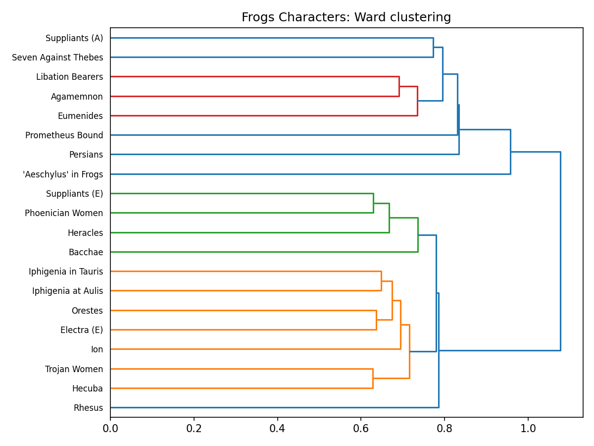

# Greek Drama TF-IDF

**Computational stylometry of extant ancient Greek drama: comparing the vocabulary of Aeschylus, Sophocles, Euripides, and Aristophanes at the author, play, and character level.**

 



*Ward clustering on TF-IDF cosine distance. Euripides's plays form one cluster; the disputed* Rhesus *falls outside it; the Oresteia groups tightly; and Aristophanes's caricatures of the two poets cluster with each other rather than with the poets they mock.*

## Research question

Do word-use patterns in Greek drama follow **genre** (tragedy vs. comedy), **author**, or something else, such as **generation**? And can vocabulary alone pick out plays whose authorship scholars already dispute?

## Key findings

> These results are provisional and exploratory (see [Limitations](#limitations)).

- **Genre shapes how the poets are imitated.** Aristophanes's characters "Aeschylus" and "Euripides" in *Frogs* cluster with each other and join the real poets' plays only at the last step. The caricatures share comedy's vocabulary more than they borrow either poet's.
- **Rhesus doesn't group with Euripides.** All eleven of Euripides's undisputed plays form a single cluster. *Rhesus*, whose authorship scholars dispute, falls outside it and groups with Aeschylus's plays instead.
- ***Prometheus Bound* is loosely attached to Aeschylus.** It joins his other plays late, alongside *Persians*, rather than with the core of his work. This weakly supports doubts about its authorship. *Persians* is also distinctive (a historical subject full of Persian names), so this result is suggestive rather than decisive.
- **The Oresteia clusters together.** *Agamemnon*, *Libation Bearers*, and *Eumenides*, the only surviving trilogy, form the tightest Aeschylus group, which is a useful check that the method works.
- **Distinctive words reveal each author's register.** Aristophanes's top terms are colloquial speech (*νή* "by Zeus!", the "this one right here" forms *τουτί* and *οὑτοσί*, *κακοδαίμων* "poor wretch"). Aeschylus's are rare, elevated words (*ἄφερτος* "unbearable", *πολισσοῦχος* "city-guarding"). Sophocles's include stylistic habits like *ἡμίν* and *ἔξοιδα*, while Euripides's are dominated by character names.

Earlier raw-count results (2016) suggested that generation mattered more than genre. With TF-IDF weighting that pattern isn't clearly visible, so it's left out pending a closer look at `results/authors_cosine.csv`.

## Quickstart

```bash
git clone https://github.com/rebekahrust/greek-tragedies-TFIDF.git
cd greek-tragedies-TFIDF
pip install -r requirements.txt
python src/preprocess.py                              # download and clean the corpus
python src/analysis.py --data-dir ~/cltk_data/tmp     # TF-IDF, similarity, charts
```

Charts, similarity matrices (CSV), and each document's most distinctive words are written to `results/`.

## Method

| Stage | What happens |
|---|---|
| **Input** | Download the Greek corpus (Perseus TEI XML) with the [Classical Language Toolkit (CLTK)](https://github.com/cltk/cltk). |
| **Pre-processing** | Parse the XML with Python's DOM parser, split each play into speaker lines (keeping line numbers), convert Beta Code to Unicode, lemmatize, standardize accents (so *δὲ* and *δέ* count as one word), strip punctuation, and remove stopwords. Output is organized as `author / play / character / lines`. |
| **Processing** | Build TF-IDF vectors with scikit-learn's `TfidfVectorizer`. TF-IDF lowers the weight of words that are common across the whole corpus, which makes up for stopwords (pronouns, forms of *εἰμί*) that get past an imperfect Greek lemmatizer. |
| **Comparison** | Measure pairwise **cosine similarity**, the primary measure because it adjusts for document length, and **Euclidean distance**, for comparison. |
| **Output** | Project the distance matrices into 2D with multidimensional scaling (MDS), cluster them with Ward's method, and plot the results at three levels: author, play, and character. MDS axes have no inherent meaning, and negative coordinates are normal; only relative position matters. |

## Repository structure

```
├── archive/2016/       # original 2016 notebooks and code, preserved as written
├── src/
│   ├── preprocess.py   # XML parsing, Beta Code → Unicode, lemmatizing, stopwords
│   └── analysis.py     # TF-IDF, cosine/Euclidean similarity, MDS, clustering
├── results/            # generated charts and similarity matrices
├── requirements.txt
└── README.md
```

## Limitations

- **The evidence is fragmentary.** Surviving Greek drama is only a sliver of what was produced, and some surviving plays (several by Euripides, for example) aren't available in the open-source Perseus corpus.
- **Lemmatization is imperfect.** The 2016-era Greek lemmatizer leaves some forms unreduced (e.g. *δαναϊδῶν*), garbles a few (*εἶἑν* for *εἶεν*), and makes some outright errors: it reads *ἐμέ* ("me") as *ἐμέω* ("to vomit"). Some names have their breathing mark on the wrong vowel (*ἐυελπίδης*). This noise is visible in the top-terms lists.
- **Similarity is not proof.** Distance measures are a way to question the data, not a basis for conclusions. As Drucker warns, visualizations can mislead humanists. These findings suggest patterns; they don't establish them.

## Applications beyond classics

The same pipeline (structured parsing → normalization → TF-IDF vectorization → similarity scoring) is used in authorship attribution, plagiarism detection, document deduplication, and security text analysis such as phishing classification and log clustering.

## Background and credits

Originally built in December 2016 as a digital humanities research project. The original version used raw word counts. The 2026 update adds true TF-IDF weighting, standardizes Greek accents so stopwords are actually removed, fixes clustering, plotting, and case-sensitive path bugs, pins the dependency versions the old toolkit needs, and replaces the notebooks with a reproducible pipeline. The original is preserved in [`archive/2016/`](archive/2016/) and as the [`v2016` release](https://github.com/rebekahrust/greek-tragedies-TFIDF/releases/tag/v2016).

- [Classical Language Toolkit](https://github.com/cltk/cltk): Kyle P. Johnson, Patrick J. Burns, et al.
- Allen Riddell's tutorials on text vectorization
- [Perseus Digital Library](http://www.perseus.tufts.edu/) for the source texts

### References

- Drucker, Johanna. "Humanities Approaches to Graphical Display." *Digital Humanities Quarterly* 5.1 (2011).
<!-- TODO: add your other footnote sources (6, 7) -->

## License

MIT
